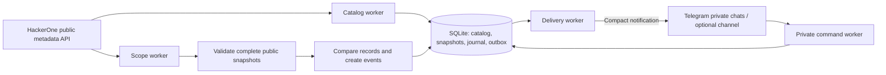

# HackerOne Tower

[](https://github.com/Arshiaheravi/hackerone-tower/actions/workflows/ci.yml)

**Public program changes → a durable change journal → short Telegram alerts.**

HackerOne Tower monitors published public HackerOne program metadata and sends short Telegram notifications for newly observed programs, policy changes, and scope additions, edits, or removals. Complete observed records and before-and-after evidence stay in the local journal.

Built with Python, HTTPX, SQLite and the Telegram Bot API. The interface is a Telegram bot and optional channel feed; there is no web dashboard. The service never connects to assets listed in scope.

[Try the offline demo](#try-it-without-credentials) · [Example alert](#example-alert) · [Architecture](#architecture) · [Verification](docs/VERIFICATION.md) · [Contributing](CONTRIBUTING.md)

## Why this project

Program directories show the current state. A useful notification service also needs to answer **what changed, when the source says it changed, and when the monitor noticed**—without confusing an existing program with a new launch.

Tower keeps that history and validates complete collections before replacing saved data. Each notification is one short message with the change, relevant asset, detection time and official link. Subscribers can follow the broad public feed or choose their own programs, asset types and bounty preferences.

## Try it without credentials

From a checkout with **Python 3.11 or newer**, install the pinned dependencies and run the offline workflow:

**Windows / PowerShell**

```powershell
python -m venv .venv
.\.venv\Scripts\python.exe -m pip install -r requirements.txt
.\.venv\Scripts\python.exe -m tower demo
```

<details>
<summary>Linux / macOS commands</summary>

```bash
python3 -m venv .venv
.venv/bin/python -m pip install -r requirements.txt
.venv/bin/python -m tower demo
```

The installed `python3` must be version 3.11 or newer.

</details>

After dependency installation, the demo runs without network access, credentials, or an `.env` file. It uses a fictional program, a temporary SQLite database, and HTTPX's mocked transport. It checks a silent initial collection, one scope addition, queued delivery, and an unchanged second observation.

The JSON result includes `"passed": true`, `"baseline_events": 0`, `"change_events": 1`, `"duplicate_events": 0`, and the rendered alert. No real Telegram message is sent. Demo detection times vary between runs.

## Example alert

**Fictional documentation fixture, rendered by the actual alert formatter.** This is the complete notification text, not a Telegram screenshot. The example grants no authorization to test any system.

```text
NEW ASSET
Program: Fictional demo program (documentation fixture)
Asset: demo.example.test
Detected: 2026-01-02 12:00 UTC
https://hackerone.com/fictional_demo
```

New-asset notifications use five lines: what happened, the program, the asset, the detection date and the official link. Updates add at most one short `Changed:` line. New-program notifications show a scope-entry count instead of an asset list. Known out-of-scope or unpaid assets retain short labels. Names and identifiers may be shortened with an ellipsis; open the official link for the complete scope and rules.

Instructions, restriction paragraphs, policies, raw JSON, internal event IDs and complete before-and-after records are not sent automatically. They remain in the local SQLite journal. “Detected” is when this monitor observed the change, not a launch date. Each alert is at most six lines and 800 UTF-16 units; ordinary new-asset alerts are much shorter. Each changed asset still receives its own notification.

[Deterministic fixture](docs/assets/fictional-event.json) · [Complete rendered example](docs/assets/fictional-alert.txt) · [Regeneration instructions](docs/assets/README.md)

## What it does

| Capability | Behavior |
| --- | --- |
| Change detection | Newly observed public programs, program and policy updates, scope changes, and scope-exclusion changes |
| Useful alerts | One short message per change, with a relevant asset or summary, detection time and official link |
| Personal preferences | Program watchlists, asset types, bounty-program filtering, pause/resume and subscriber deletion |
| Durable processing | Complete snapshots, event history and recipient outbox in SQLite; unchanged observations do not create duplicate events |
| Recovery | Bounded retries, persisted retry times, consistent backups, worker health checks and Windows task recovery |
| Freshness | Two scope workers share one request budget; status measures the proportion of public programs checked within the freshness window and warns the operator when the target is missed |
| Read accuracy and retries | ID-cursor scope traversal avoids shifting offsets; persistent per-program failures receive bounded retries and remain visible until successful collection or confirmed deactivation |
| Privacy boundary | Confirmed public programs and allowlisted fields only; private programs and account-specific data are excluded |

## The Telegram experience

1. Open the bot's private chat and send `/start`. Existing preferences are retained and alerts resume.
2. Choose **Watch everything** for the widest coverage of public programs returned by the API. It turns alerts on and clears every personal filter.
3. Use **My settings** to see the active filters and warnings about hidden new-program announcements.
4. Read **Quick guide**, then use **Recent changes** and **Monitoring status** to inspect the feed and its freshness.

The persistent keyboard also offers **Bounty programs**, **Pause alerts**, and **Resume alerts**. If a Telegram client hides it, `/menu` shows it again. The 16 slash commands remain available.

<details>
<summary>Command reference and filter behavior</summary>

| Command | Behavior |
| --- | --- |
| `/start`, `/help` | Subscribe/resume with saved filters, or show help |
| `/menu`, `/guide` | Show the buttons or built-in guide |
| `/all` | Enable alerts and clear program, asset-type and bounty filters |
| `/watch example other`, `/watch all` | Replace the program shortlist, or clear only that shortlist |
| `/types URL WILDCARD`, `/types all` | Select asset types, or clear only that filter |
| `/bounties on`, `/bounties off` | Restrict to bounty programs, or include paid and unpaid programs |
| `/pause`, `/resume` | Pause and cancel pending alerts, or resume future changes without replay |
| `/settings` | Display readable preferences without personal identifiers |
| `/recent [handle]` | Up to five recent public events, independent of personal filters |
| `/program handle` | Cached public details, scope/exclusion counts and the official link |
| `/status` | Monitoring health, collection coverage, snapshot ages and delivery problems |
| `/privacy`, `/delete_me` | Explain retention, or erase the subscription and its delivery records |

Send one command per message; pasted command batches are rejected before preferences change. A watchlist hides discoveries outside the shortlist. An asset-type filter can hide new programs with no matching scopes. **Bounty programs** keeps existing filters, and program-level bounty availability does not make every asset eligible for payment.

Personal filters do not change source collection. An optional channel receives the observed public-change feed without personal filtering.

</details>

## Architecture



Catalog discovery, scope collection, Telegram polling and delivery run independently. Catalog and scope requests share bounded API budgets. Snapshot replacement, event creation and recipient outbox insertion commit together. Slow scope pagination does not block command handling or catalog discovery.

| Layer | Implementation |
| --- | --- |
| Runtime | Python 3.11+, independent workers, graceful shutdown and single-instance lock |
| Integrations | HTTPX; fixed official API hosts; bounded timeouts and retries |
| Persistence | SQLite with WAL, transactions, schema migrations and consistent backups |
| Delivery and interface | Telegram Bot API, durable single-message notifications, validated text-only reply keyboards |
| Verification | pytest, HTTPX MockTransport, temporary databases, coverage and Ruff |
| Deployment | Windows logon/recovery scripts; Docker/Compose configuration for a later Linux deployment |

[Architecture invariants and source map](docs/ARCHITECTURE.md) · [Official API contracts and observed differences](docs/SOURCES.md)

## Engineering decisions

| Decision | Benefit and tradeoff |
| --- | --- |
| Full collection reconciliation | Detects removals as well as additions. Costs more API requests; pagination is not an atomic server snapshot. |
| Separate catalog and scope workers | Keeps discovery progressing during large scope collections. Shared pacing and bounded priority bursts preserve ordinary refresh turns. |
| SQLite plus a durable outbox | Keeps deployment small and preserves work across restarts. A single-process design needs measured queue and storage limits before serving a large audience. |
| Silent initial collection | Avoids presenting the existing catalog as new launches. Initial programs do not generate discovery alerts. |
| Compact plain-text messages | Source content cannot become Telegram markup. Notifications stay short; complete records remain local and current details are available through the official link. |
| Retry-safe persistence | Event identity and delivery state survive restarts. Telegram has no send idempotency key, so an ambiguous timeout can still cause duplicate delivery. |

Regression cases include public-to-private transitions, incomplete collections, cursor rollover beyond 10,000 scope records, migration rollback, cosmetic image-URL churn, and a Telegram rate-limit retry across database restart.

## Connect a live instance

Use [.env.example](.env.example) as the configuration reference. Keep real values in a local, ignored `.env`; never add credentials to source or issue reports. The Windows setup helper creates the file if it is missing and preserves an existing one:

```powershell
.\scripts\setup.ps1
```

| Setting | Purpose |
| --- | --- |
| `H1_USERNAME`, `H1_API_TOKEN` | HackerOne account username and personal API token |
| `TELEGRAM_BOT_TOKEN` | Token for a bot created through Telegram's `@BotFather` |
| `TELEGRAM_CHANNEL_ID` | Optional channel destination; leave empty for personal opt-in subscriptions only |
| `TELEGRAM_ADMIN_CHAT_ID` | Optional private operator destination for health notifications |

Edit `.env` locally, then run the read-only checks and install the private-chat command menu:

```powershell
.\.venv\Scripts\python.exe -m tower check-source
.\.venv\Scripts\python.exe -m tower check
.\.venv\Scripts\python.exe -m tower setup-bot
.\scripts\start.ps1
```

`check-source` reads the catalog and one complete public snapshot. `check` verifies API access. `setup-bot` installs and reads back the 16 commands; it sends no message. Open the bot and send `/start` to subscribe. Only one process should poll a bot token, and an existing webhook must be resolved before polling.

Channel delivery needs the bot to have posting permission. See [operations](docs/OPERATIONS.md) for channel/private-chat setup, explicit delivery checks, schema upgrades, backups, Windows recovery and Linux migration. Commands such as `send-test` and `scripts.live_delivery_check` **send real messages** to the configured destination; the offline demo does not.

## Freshness, safety and scope

The default catalog interval is **120 seconds after a completed fetch**. Scope requests are paced at **40/minute**, within a shared 300-request/minute budget. The target scope revisit interval is 15 minutes, but pagination, catalog size, latency and cooldowns can make a full rotation much longer. For 1,000 one-page programs, scope pacing alone imposes a 25-minute floor. `/status` shows the actual oldest snapshot age; a complete baseline does not imply current data for every program.

“First observed” means first seen by this installation, not a public launch date. Changes made and reverted between polls can be missed. Source dates and unavailable fields are not inferred. A program absent from the catalog is treated as unavailable, not confirmed deleted.

The service does not scrape private endpoints, bypass access controls, scan assets, estimate competition, or predict vulnerability discovery. Subscribers must check the current program policy, scope, exclusions and authorization at the source. This is an independent project, not an official HackerOne or Telegram service.

Windows monitoring requires an awake, online, logged-in session. Recovery triggers do not make a laptop an always-available host. Hosted Windows/Linux CI and the offline Docker runtime check passed; see the [release evidence](docs/RELEASE.md). VPS operation and a sustained production soak remain separate verification gates. Redistribution/commercial permission must be confirmed before a public or paid feed; billing and paid access control are not implemented.

## Verification and development

The current suite passes **575 tests** on Windows and Linux with Python 3.11 and 3.12. The local Windows run measured **95% statement coverage**. The [release record](docs/RELEASE.md) links the actual hosted CI results, including package and Docker checks. [Earlier live verification](docs/VERIFICATION.md) records prior delivery, recovery and baseline checks. Code coverage is not detection accuracy. API acceptance and human receipt are separate evidence; none of these checks guarantees uninterrupted operation or perfect detection.

Install the development requirements and run the offline checks:

```powershell
.\.venv\Scripts\python.exe -m pip install -r requirements-dev.txt
.\.venv\Scripts\python.exe -m pip check
.\.venv\Scripts\python.exe -m ruff check .
.\.venv\Scripts\python.exe -m ruff format --check .
.\.venv\Scripts\python.exe -m pytest --cov=tower --cov-report=term-missing
.\.venv\Scripts\python.exe -m tower demo
```

The [checks workflow](.github/workflows/ci.yml) configures these gates:

| Gate | Configured checks |
| --- | --- |
| Python 3.11/3.12 on Windows/Linux | Dependency compatibility, Ruff, offline tests, source demo, wheel build and installed-wheel smoke check outside the checkout; Windows script syntax on Windows |
| Secrets | Full-history Gitleaks scan using a pinned version and verified release checksum; findings are redacted |
| Container | Image build, unprivileged-user assertion, and the demo with networking disabled, a read-only filesystem and dropped capabilities |

The tests reject live DNS/socket connections during execution. The installed-wheel probe also blocks live networking and strips application credentials from its child-process environment. Dependency installation and image building still need network access. A configured gate is not evidence of a successful hosted run; check the actual workflow results and the release record.

[Contributing](CONTRIBUTING.md) · [Security and privacy](SECURITY.md) · [Operations](docs/OPERATIONS.md) · [MIT license](LICENSE)
