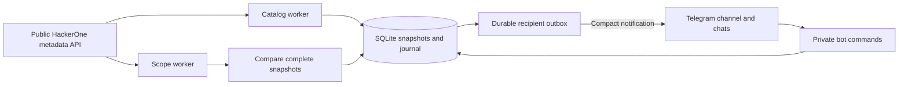

# Architecture and verification

`source.py` reads documented HackerOne APIs. `domain.py` compares complete normalized snapshots. `store.py` commits snapshots, events and delivery rows together. `service.py` schedules catalog, scope, command and delivery workers. `bot.py` implements opt-in preferences and the button-driven interface. `keyboards.py` constrains menus to bounded text-only actions. `health.py` shares health evaluation between the CLI and the readable bot status. `telegram.py` is the Bot API adapter; `render.py` produces compact single-message notifications. `cli.py` provides setup checks and operations.

## Invariants

1. Credentials go only to fixed official hosts over HTTPS. Redirects are refused; pagination is constrained to the same resource and allowed parameters. Source text is never code or Telegram markup.
2. Only `public_mode` programs and explicitly allowlisted fields are accepted. Account-specific fields are excluded. Scope assets are never contacted.
3. Complete catalog/scope/exclusion traversals must succeed before commit. Structured scopes advance by the last observed ID on every page, avoiding skipped surviving rows when deletions shift page-number offsets. Full terminal pages get a cursor probe, even without a next link. Returned links still undergo same-origin/resource validation. Malformed data, duplicate IDs and pagination loops fail closed. Detail visibility is rechecked after collecting scope.
4. Initial baseline membership persists across restarts. Existing programs are not announced as new launches. First-observed dates are distinct from source dates.
5. Snapshot/event/outbox updates are atomic. Identical content, update-timestamp changes and profile-image URL churn create no events; source values remain in snapshots. Scope IDs preserve identity through name changes.
6. API pagination is not a server transaction: simultaneous source edits may produce inconsistent observations. Reconciliation repeats; no perfect-completeness claim is made.
7. Delivery state and ordering survive retries and restarts, including older multipart rows and long command replies. New change notifications contain one bounded message. Telegram has no send idempotency key, so duplicates remain possible after ambiguous failures.
8. The catalog worker and one or two scope workers share the same request budgets. Scope workers atomically reserve distinct program IDs in memory before fetching; a large snapshot can no longer block all progress when the second worker is free. Claims release on success or failure and disappear on process restart. Priority bursts remain bounded. There is still one monitor process and one Telegram update consumer.
9. Operational health is separate from baseline readiness. Worker/progress/backlog ages and per-program snapshot freshness affect health; every active program needs a completed snapshot before `ready` becomes true. Freshness uses all API-visible public programs as the denominator, including missing snapshots. The target is at least 99% checked within the greater of 30 minutes and twice the scope-refresh interval. Startup collection gets one window before missing snapshots cause a freshness warning; stale existing snapshots still count immediately. A passing freshness measurement does not establish detection recall or historical uptime.
10. Schema v3 persists optional reply-keyboard metadata with command replies. Migration is atomic, legacy messages retain null metadata, and the dispatcher preserves metadata across retries/restarts. Menus are sent only to canonical positive private-chat IDs; alerts and channel broadcasts keep ordinary text payloads.
11. The local journal retains complete observed records and before/after evidence. Automatic notifications omit instructions, restriction paragraphs, policies, raw JSON and internal event IDs. A new asset uses five lines: change title, program, asset, detection time and official link. Updates add at most one short change summary. Known false eligibility uses inline out-of-scope/no-bounty labels. New programs show only a scope-entry count. All event notifications fit six lines and 800 UTF-16 units, preserving the complete official link and detection time. Ellipses mark shortened fields; no event kinds are filtered out by presentation.
12. Schema v4 adds per-program failure records. An unresolved failure stays visible until the same program commits a complete snapshot; another program's success cannot clear it. Failure state and retry scheduling are atomic. Retry delay starts at 60 seconds, doubles to at most one hour, and honors longer server deadlines. Priority retries retain fairness and rank below new discoveries. Catalog changes do not shorten retry deadlines. Confirmed deactivation removes the failure and cancels unsent alerts. Shared source cooldowns also persist across process restarts.

## Verification

Tests use fixtures, temporary SQLite databases and `httpx.MockTransport`. They never contact program assets or send real Telegram messages.

| Area | Checks |
| --- | --- |
| Source | Public fields, pagination/cursor rollover, credentials, redirects, malformed/partial responses, rate limits |
| Domain | Discovery, scope/exclusion additions/edits/removals, noise suppression, preferences, before/after values |
| Persistence | Rollback, restart deduplication, silent baseline, privacy cancellation, retry ordering, backup/retention |
| Telegram | HTTP/API errors, 429 cooldown, redacted exceptions, Unicode-safe bounded notifications and durable retries |
| Commands | Opt-in, filters, pause/resume, replay, long preferences, malformed input, erasure |
| Workflow | Fixture observation through journal and mocked Telegram acceptance; stale source and failure recovery |
| Operations | CLI demo/health, configuration, instance lock, PowerShell syntax |

Run `python -m pytest --cov=tower --cov-report=term-missing`, `python -m ruff check .`, `python -m ruff format --check .`, and `python -m pip check` in the project virtual environment. CI covers Python 3.11/3.12 on Windows/Linux when actually run. Local passing checks do not prove hosted CI, Docker runtime or real channel delivery.

Live preflight commands (`check` and `check-source`) are read-only. The separate `send-test` and `scripts.live_delivery_check` commands explicitly send labelled Telegram test messages to a configured destination. Host suspension, upstream outages and unavailable credentials cannot be eliminated by unit tests. No 100% uptime, earliest-detection or bounty-outcome guarantee is made.
